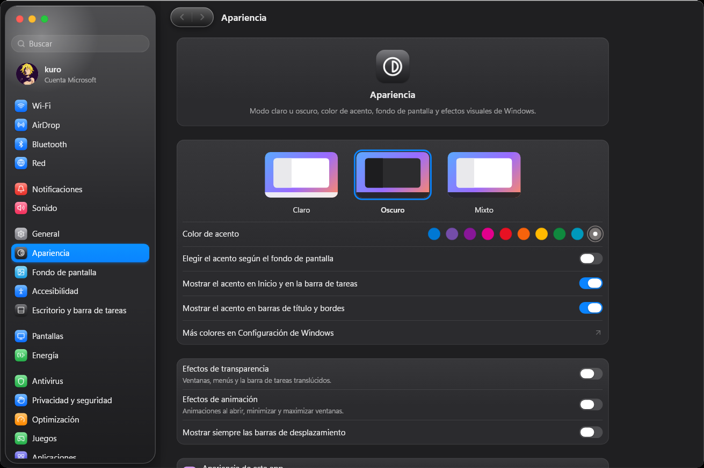

# LiquidControl


LiquidControl reúne la configuración y optimización de Windows 10/11 en una aplicación nativa, rápida y reversible,
con una interfaz inspirada en Ajustes del Sistema de macOS.



## Características

- Interfaz nativa en Rust y Slint, sin WebView.
- Un único ejecutable portable; no requiere instalación.
- Ajustes reales mediante Win32, COM, WinRT y el Registro de Windows.
- Historial de actividad visible y ajustes reversibles.
- Se ejecuta como usuario normal y solicita UAC solo cuando hace falta.
- Modo claro, oscuro y mixto, acentos, animaciones y Liquid Glass.

## Paneles

- Cuenta de Windows e iCloud
- Wi-Fi, AirDrop, Bluetooth y red
- Notificaciones, sonido y mezclador por aplicación
- Apariencia, fondos de pantalla y accesibilidad
- Escritorio, pantallas, energía, privacidad y antivirus
- Optimización, juegos y aplicaciones
- Mouse, teclado, idiomas y distribuciones
- Ajustes y consola de actividad de LiquidControl

## Descargar

La versión lista para usar está en [Releases](https://github.com/xXKuroiKenshiXx/LiquidControl/releases).

1. Descargá el archivo portable de la versión más reciente.
2. Extraé el ZIP en una carpeta con permisos de escritura.
3. Ejecutá `liquidcontrol.exe`.

El paquete incluye `portable.txt`, por lo que preferencias, registros, caché y copias de seguridad se guardan en la
carpeta `data` junto al ejecutable.

## Compilar

Requisitos: Windows 10/11, [Rust](https://rustup.rs) 1.85 o posterior y Visual Studio Build Tools con el SDK de
Windows.

```powershell
cargo build --release -p liquidcontrol
cargo test --workspace
```

El ejecutable queda en `target/release/liquidcontrol.exe`. La arquitectura y el mapa de módulos están documentados
en [`docs/ARQUITECTURA.md`](docs/ARQUITECTURA.md).

## Seguridad

- Las acciones del catálogo están embebidas en el binario y no aceptan comandos arbitrarios.
- Antes de aplicar un ajuste reversible se guarda el estado anterior en `journal.json`.
- Los procesos se lanzan por ruta absoluta y con argumentos separados.
- AirDrop está apagado de forma predeterminada y solo escucha en la red local cuando el usuario lo activa.
- Las contraseñas de Wi-Fi se entregan directamente a Windows y no se escriben en los registros.

## Contribuir

Leé [`CONTRIBUTING.md`](CONTRIBUTING.md) antes de abrir un pull request.

## Licencia

LiquidControl es software libre publicado bajo la [GNU General Public License v3.0](LICENSE). Los componentes de
terceros conservan sus licencias; los avisos correspondientes están en [`THIRD_PARTY_NOTICES.md`](THIRD_PARTY_NOTICES.md).
